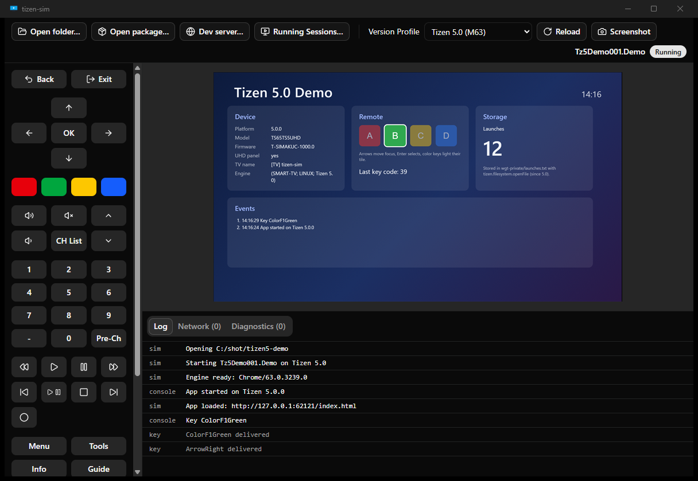
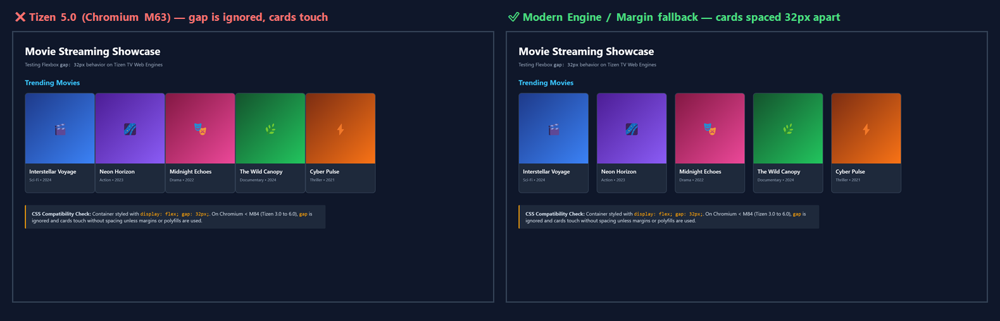
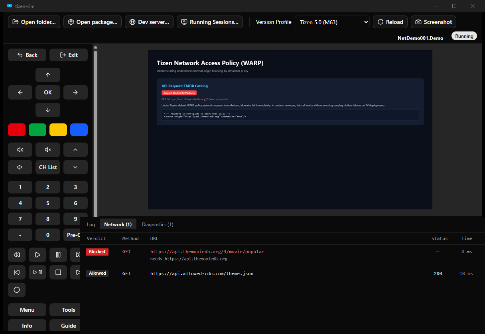
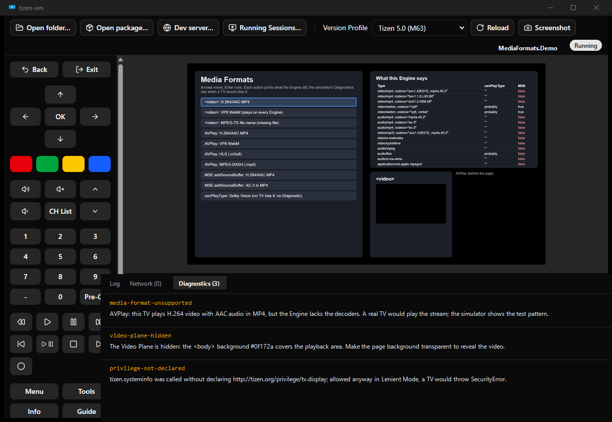

# tizen-sim

An open-source desktop simulator for **Samsung Tizen TV web apps**, built as a replacement for Samsung's TV Web Simulator.

A Tizen TV runs your App on an old, fixed version of Chromium, with its own platform APIs, remote control, network rules and video layering. tizen-sim runs your App on the **same Chromium milestone the target TV generation ships** and reproduces what that TV's platform does to it. What you see on the desktop is what you'd see on the TV, without deploying to a device for every change.



- **The TV's browser engine.** Each Version Profile pins the Chromium build its TVs ship, downloaded on first use: Chromium M47 for Tizen 3.0 (2017 TVs) up to Chromium M130 for Tizen 10.0 (2026 TVs).
- **Platform APIs.** `tizen.*` and `webapis.*` Shims behave as documented, including their errors and privilege checks: calling an API without the privilege your `config.xml` declares throws `SecurityError`, as on the TV.
- **The remote control.** Remote Keys arrive the way the TV delivers them, with `tizen.tvinputdevice` registration. The platform's own key handling is included, for example holding Back terminates the App.
- **Network rules.** Your `config.xml` Access Policy (WARP `<access>` or CSP) is enforced through a proxy, and every request is listed in a Network Log.
- **Lifecycle.** Hiding and resuming fire `visibilitychange` and pause JavaScript, and background support is honoured.
- **Video.** AVPlay plays on a Video Plane behind the page, so transparent regions show the video as they do on a TV.
- **Diagnostics.** tizen-sim flags code that behaves differently, or fails, on a real TV.
- **A fast loop.** Hot reload (including your own bundler's dev server), console streaming, DevTools, screenshots, a CLI and a desktop GUI.

> **Status:** early development. The product spec is [#23](https://github.com/lucaskfp/tizen-sim/issues/23); its sub-issues are the roadmap.

## Supported platforms and TVs

| Version Profile | Engine         | Windows x64 | Linux x64 |
| --------------- | -------------- | ----------- | --------- |
| Tizen 10.0      | Chromium M130  | yes         | yes       |
| Tizen 9.0       | Chromium M120  | yes         | yes       |
| Tizen 8.0       | Chromium M108  | yes         | yes       |
| Tizen 7.0       | Chromium M94   | yes         | yes       |
| Tizen 6.5       | Chromium M85   | yes         | yes       |
| Tizen 6.0       | Chromium M76   | yes         | yes       |
| Tizen 5.5       | Chromium M69   | yes         | yes       |
| Tizen 5.0       | Chromium M63   | yes         | yes       |
| Tizen 4.0       | Chromium M56   | yes         | yes       |
| Tizen 3.0       | Chromium M47   | yes         | yes       |

- **Version Profiles.** Every TV release from Tizen 3.0 to 10.0. `tizen-sim profiles` lists them.
- **Linux** is a tier 2 platform. [docs/linux.md](docs/linux.md) lists where it differs from Windows and what it needs from the system, such as GConf for the Tizen 3.0 to 5.0 Engines.
- **macOS** is not supported.

## Common use cases

### Catching CSS and JS incompatibilities on older TV engines

A real TV runs your App on a fixed Chromium milestone that never updates. Features taken for granted on desktop browsers fail on older TV generations:

- **Flexbox `gap`** was added in Chromium M84 (Tizen 6.5). On Tizen 3.0 to 6.0 (2017 to 2021 TVs), `gap` is ignored and elements collapse together unless a margin fallback is used.
- **Modern JavaScript syntax**, such as optional chaining (`?.`) and nullish coalescing (`??`), arrived in Chromium M80 (Tizen 6.0). Running untranspiled ES2020 code on Tizen 3.0 to 5.5 throws `SyntaxError` on load.

Running with `--profile 5.0` or choosing it in the GUI runs your App in Chromium M63, exposing these layout and syntax bugs immediately.



### Catching undeclared network requests (WARP)

Tizen TVs run in **WARP mode** by default: any request to an external origin (APIs, asset CDNs) is refused unless declared in `<access origin="..." subdomains="true"/>` in `config.xml`. Desktop browsers allow these requests without warning.

tizen-sim routes network traffic through a proxy that enforces the Access Policy. Denied requests are blocked, flagged in the **Network Log** panel with what was missing, and reported as an `access-not-declared` Diagnostic.



### Enforcing platform privileges and diagnosing video layering

- **Platform privileges.** Calling `tizen.*` and `webapis.*` APIs without declaring the required `<tizen:privilege>` in `config.xml` throws `SecurityError` on a TV. In Lenient Mode (`--lenient`), tizen-sim allows execution to continue while recording a `privilege-not-declared` Diagnostic.
- **Video Plane layering.** AVPlay renders hardware-decoded video to a plane *behind* the web page. An opaque CSS background on `<body>` or a container covers the video, leaving only audio playing. tizen-sim emulates the Video Plane and raises a `video-plane-hidden` Diagnostic when opaque content conceals the playback area.
- **Media decoders.** When an App plays or probes formats that the target TV supports but the desktop Engine lacks (e.g. H.264 on snapshot milestones or MPEG-TS), tizen-sim raises `media-format-unsupported` to confirm the TV would play it.




## Getting started

Download the latest release from [GitHub Releases](https://github.com/lucaskfp/tizen-sim/releases):

| Platform    | GUI                                                   | CLI                                    |
| ----------- | ----------------------------------------------------- | -------------------------------------- |
| Windows x64 | `tizen-sim_<version>_x64-setup.exe` (or the `.msi`)   | `tizen-sim-cli-<version>-windows-x64.zip` |
| Linux x64   | `tizen-sim_<version>_amd64.AppImage` (or the `.deb`)  | `tizen-sim-cli-<version>-linux-x64.tar.gz` |

- **Windows.** The installers aren't code-signed yet, so SmartScreen warns about an unknown publisher on first run: choose *More info*, then *Run anyway*.
- **Linux.** Install the system packages in [docs/linux.md](docs/linux.md) for the Engines you use.
- **Updates.** The GUI shows its installed version in its toolbar. It checks for a newer release when it starts and offers it there too: *Update to <version>* installs it and restarts the GUI. The CLI is updated by hand; `tizen-sim --version` shows its version.
- Engines are downloaded to `~/.tizen-sim/engines` the first time a Version Profile is used; set `TIZEN_SIM_HOME` to keep tizen-sim's data elsewhere.

### Building from source

You need:

- [Rust](https://rustup.rs) (stable). The CLI needs nothing else.
- [Node.js](https://nodejs.org) 24, for the GUI or for changing the Shims.
- On Linux, the system packages listed in [docs/linux.md](docs/linux.md).

```bash
git clone https://github.com/lucaskfp/tizen-sim.git
cd tizen-sim
cargo build --release -p tizen-sim
```

The CLI binary is `target/release/tizen-sim`. The GUI's installers come from `npx tauri build` in `crates/tizen-sim-gui`.

### The CLI

```bash
# Run a Project Folder (a directory with a config.xml) and stream its console
tizen-sim run path/to/my-app

# Run a packaged .wgt on the Tizen 3.0 Engine
tizen-sim run my-app.wgt --profile 3.0

# Run your bundler's dev server, with the App's config.xml
tizen-sim run http://localhost:5173 --config path/to/config.xml

# Open DevTools once the App has loaded
tizen-sim run path/to/my-app --devtools
```

`run` keeps going until Ctrl+C and reloads the App when its files change. These commands act on a running Session from another terminal:

```bash
tizen-sim sessions                 # list running Sessions
tizen-sim key Back                 # press a Remote Key
tizen-sim reload                   # reload the App
tizen-sim screenshot               # save a PNG at the TV's resolution
tizen-sim reset                    # forget what the App stored, for a first launch
tizen-sim engines                  # list, fetch and remove cached Engines
```

Run `tizen-sim help <command>` for every option. `run` also takes these:

- `--headless`: no window.
- `--lenient`: allow calls a TV would refuse, reporting each as a Diagnostic.
- `--map-key`: map a keyboard key to a Remote Key.
- `--device`: override the device values the APIs report.
- `--resolution`: 1920x1080 or 1280x720.
- `--gamepad`: a gamepad model to take as connected, for Apps whose `gamepad` metadata requires one.
- `--engine-path`: use your own Chromium build.

### The GUI

The desktop GUI does everything the CLI does. It adds an on-screen remote, a Version Profile switcher, and the log, Network Log and Diagnostics in panels. It can also adopt a Session started from the CLI.

```bash
cd crates/tizen-sim-gui
npm ci
npm run tauri dev
```

See [crates/tizen-sim-gui/README.md](crates/tizen-sim-gui/README.md) for details.

## How it works

- **Engines.** Each Engine is a pinned Chromium build run as an external process and driven over the DevTools protocol (ADR-0001).
- **Shims.** A local dev server serves your App and injects the Shims into its HTML (ADR-0002). The Shims are TypeScript compiled to ES5, so they run on every Engine down to M47.
- **Network.** Traffic goes through a proxy that enforces the App's Access Policy (ADR-0003).
- **Video.** The AVPlay Video Plane is emulated in the page (ADR-0004).

Every architectural decision is recorded in [docs/adr/](docs/adr/).

| Path                      | What it is                                                                          |
| ------------------------- | ----------------------------------------------------------------------------------- |
| `crates/tizen-sim-core`   | The simulator: Sessions, Engines, Version Profiles, the dev server, network proxy and Shim host |
| `crates/tizen-sim-cli`    | The `tizen-sim` command-line tool                                                   |
| `crates/tizen-sim-gui`    | The desktop GUI (Tauri v2, React, TypeScript)                                       |
| `shims/`                  | The in-page `tizen.*` and `webapis.*` Shims                                         |
| `fixtures/apps/`          | Tiny Apps used by the test suites                                                   |
| `docs/`                   | ADRs, Linux notes, and the documented TV behaviour the simulator follows            |

## Scope

tizen-sim emulates **the platform**: what a Tizen TV does for and to an App. It does not judge **how an App should behave**. Samsung's UX guidelines and certification checklist (exit popups, focus rules, launch-time targets) are the App developer's concern, and the simulator neither enforces nor checks them. When in doubt, ask: *does the TV do this, or does Samsung tell the App to do it?* Only the first belongs here.

Also out of scope:

- DRM playback
- Tizen 2.x/WebKit TVs
- packaging and signing `.wgt` files
- Tizen Studio integration
- decrypting HTTPS
- non-TV Tizen profiles
- macOS

## Contributing

Contributions are welcome through [issues](https://github.com/lucaskfp/tizen-sim/issues): bug reports, behaviour you've measured on a real TV, proposals and fixes. Pull requests are open to collaborators only. [CONTRIBUTING.md](CONTRIBUTING.md) covers how to report issues, how platform behaviour must be sourced, the development setup and the pull request flow. Everyone taking part follows the [Code of Conduct](CODE_OF_CONDUCT.md), and security issues are reported as [SECURITY.md](SECURITY.md) describes.

## License

Licensed under either of [MIT](LICENSE-MIT) or [Apache-2.0](LICENSE-APACHE), at your option.
